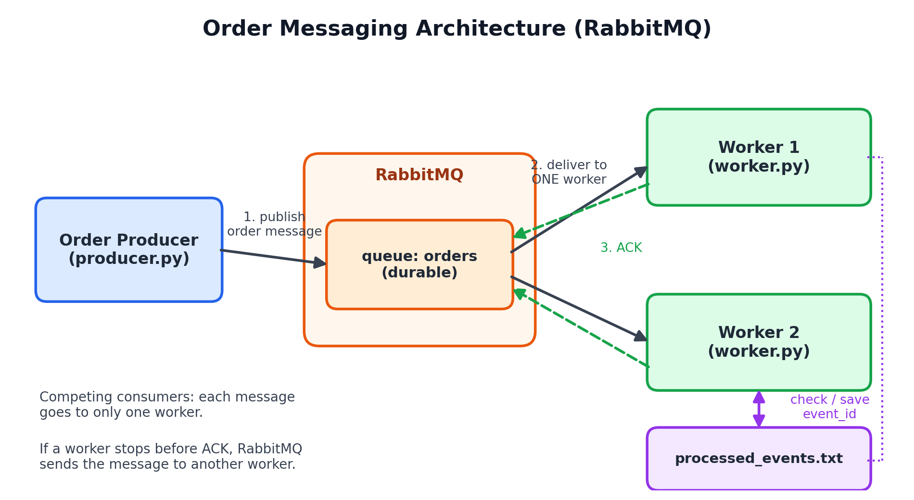
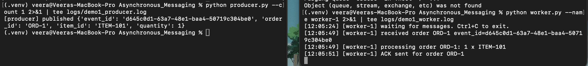
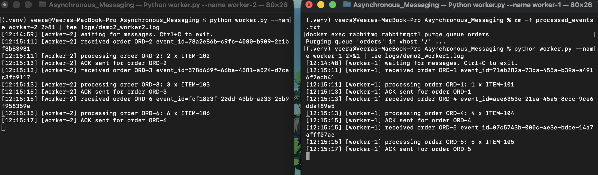
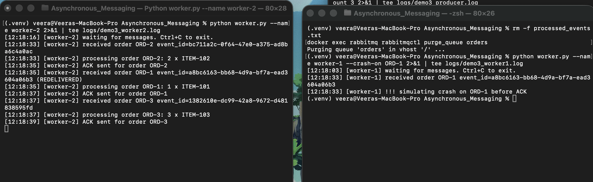
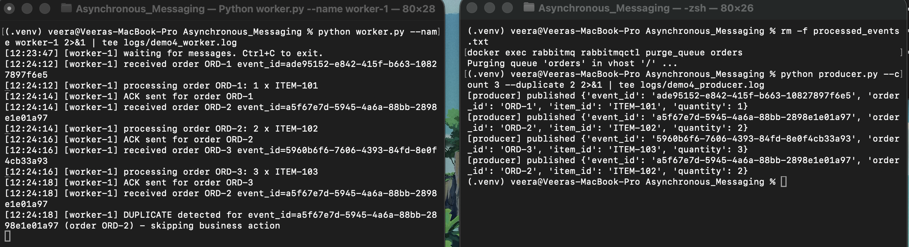

# Module 5: Asynchronous Messaging with RabbitMQ

In this project I built a small order system using **RabbitMQ** and **Python**. One program (the **producer**) sends order messages. Other programs (the **workers**) take these messages from a queue and process them. The producer and the workers run as separate processes, so they do not need to wait for each other. That is what "asynchronous" means.

I tested four things:
1. A worker can process a message and send an ACK.
2. Two workers can share one queue (competing consumers).
3. If a worker crashes before ACK, another worker gets the message again.
4. If the same event comes two times, it is processed only one time.

##Architecture



- The producer puts messages in the `orders` queue inside RabbitMQ.
- RabbitMQ gives each message to **only one** worker.
- A worker sends an **ACK** after it finishes. ACK means "I am done, you can delete this message".
- If a worker dies before ACK, RabbitMQ puts the message back and gives it to another worker.
- Before doing any work, a worker checks `event_id`. If it was already processed, the worker skips it.

## Message format

Each order message has four fields:

```json
{
  "event_id": "unique id for this event",
  "order_id": "ORD-1",
  "item_id": "ITEM-101",
  "quantity": 1
}
```

## Files in this project

| File | What it does |
|---|---|
| `producer.py` | Sends order messages to the queue |
| `worker.py` | Receives orders, logs them, sends ACK, detects duplicates |
| `docker-compose.yml` | Starts RabbitMQ in Docker |
| `requirements.txt` | Python library list (`pika`) |
| `logs/` | Raw terminal output from all my tests |
| `screenshots/` | Screenshots from all my tests |

---

## How to run

You need Python 3.8+, Docker and Docker Compose. I used a Mac. (`worker.py` uses `fcntl`, so it works on macOS and Linux. On Windows, please use WSL.)

**Step 1: Install the Python library**
```bash
python3 -m venv .venv
source .venv/bin/activate
pip install -r requirements.txt
```

**Step 2: Start RabbitMQ**
```bash
docker compose up -d
```
Wait about 20 seconds. You can open the web page at http://localhost:15672 (username `guest`, password `guest`).

**Step 3: Start two workers** (use two terminals)
```bash
python worker.py --name worker-1
python worker.py --name worker-2
```

**Step 4: Run the producer** (use a third terminal)
```bash
python producer.py --count 6
```

**Step 5: Stop RabbitMQ when finished**
```bash
docker compose down
```

### Extra options

| Option | Meaning |
|---|---|
| `producer.py --count N` | Send N orders |
| `producer.py --duplicate K` | Send order number K one more time with the **same** `event_id` |
| `worker.py --crash-on ORD-1` | Worker stops without ACK the first time it gets ORD-1 |
| `worker.py --delay 2` | Seconds the worker "works" on each order |

Before each test, I cleaned the old data with:
```bash
rm -f processed_events.txt
docker exec rabbitmq rabbitmqctl purge_queue orders
```

---

## Evidence

All logs below are real output from my terminal. The full files are in the `logs/` folder.

### 1. Successful message processing

I started one worker and sent one order (`python producer.py --count 1`).

Producer:
```
[producer] published {'event_id': 'd645c0d1-63a7-48e1-baa4-50719c304be0', 'order_id': 'ORD-1', 'item_id': 'ITEM-101', 'quantity': 1}
```

Worker:
```
[12:05:24] [worker-1] waiting for messages. Ctrl+C to exit.
[12:05:49] [worker-1] received order ORD-1 event_id=d645c0d1-63a7-48e1-baa4-50719c304be0
[12:05:49] [worker-1] processing order ORD-1: 1 x ITEM-101
[12:05:51] [worker-1] ACK sent for order ORD-1
```

**What this shows:** the worker received the order, processed it (2 seconds), and then sent the ACK.



---

### 2. Two competing consumers

I started two workers on the same queue and sent 6 orders (`python producer.py --count 6`).

worker-1:
```
[12:14:48] [worker-1] waiting for messages. Ctrl+C to exit.
[12:15:11] [worker-1] received order ORD-1 event_id=71eb282a-73da-455a-b39a-a4916f2edb41
[12:15:11] [worker-1] processing order ORD-1: 1 x ITEM-101
[12:15:13] [worker-1] ACK sent for order ORD-1
[12:15:13] [worker-1] received order ORD-4 event_id=aee6353e-21ea-45a5-8ccc-9ce6ddaf89e5
[12:15:13] [worker-1] processing order ORD-4: 4 x ITEM-104
[12:15:15] [worker-1] ACK sent for order ORD-4
[12:15:15] [worker-1] received order ORD-5 event_id=07c5743b-000c-4e3e-bdce-14a7afff07ae
[12:15:15] [worker-1] processing order ORD-5: 5 x ITEM-105
[12:15:17] [worker-1] ACK sent for order ORD-5
```

worker-2:
```
[12:14:59] [worker-2] waiting for messages. Ctrl+C to exit.
[12:15:11] [worker-2] received order ORD-2 event_id=78a2e86b-c9fc-4080-b909-2e1bf3b83931
[12:15:11] [worker-2] processing order ORD-2: 2 x ITEM-102
[12:15:13] [worker-2] ACK sent for order ORD-2
[12:15:13] [worker-2] received order ORD-3 event_id=578d669f-66ba-4581-a524-d7cec3fb9117
[12:15:13] [worker-2] processing order ORD-3: 3 x ITEM-103
[12:15:15] [worker-2] ACK sent for order ORD-3
[12:15:15] [worker-2] received order ORD-6 event_id=fcf1823f-20dd-43bb-a233-25b9f958359e
[12:15:15] [worker-2] processing order ORD-6: 6 x ITEM-106
[12:15:17] [worker-2] ACK sent for order ORD-6
```

**What this shows:**

| Worker | Orders handled |
|---|---|
| worker-1 | ORD-1, ORD-4, ORD-5 |
| worker-2 | ORD-2, ORD-3, ORD-6 |

Every order was handled by only one worker. No order appears in both logs. The workers are competing for messages, and the work is shared.



---

### 3. Failure and redelivery

I started worker-1 with `--crash-on ORD-1`. This makes it stop after it receives ORD-1, **before** sending ACK. I also started a normal worker-2. Then I sent 3 orders.

worker-1 (crashes):
```
[12:18:03] [worker-1] waiting for messages. Ctrl+C to exit.
[12:18:33] [worker-1] received order ORD-1 event_id=a8bc6163-bb68-4d9a-bf7a-ead3604a06b3
[12:18:33] [worker-1] !!! simulating crash on ORD-1 before ACK
```

worker-2 (gets the message again):
```
[12:18:16] [worker-2] waiting for messages. Ctrl+C to exit.
[12:18:33] [worker-2] received order ORD-2 event_id=bc711a2c-0f64-47e0-a375-ad8ba6c4a0ac
[12:18:33] [worker-2] processing order ORD-2: 2 x ITEM-102
[12:18:35] [worker-2] ACK sent for order ORD-2
[12:18:35] [worker-2] received order ORD-1 event_id=a8bc6163-bb68-4d9a-bf7a-ead3604a06b3 (REDELIVERED)
[12:18:35] [worker-2] processing order ORD-1: 1 x ITEM-101
[12:18:37] [worker-2] ACK sent for order ORD-1
[12:18:37] [worker-2] received order ORD-3 event_id=1382610e-dc99-42a8-9672-d481838595fd
[12:18:37] [worker-2] processing order ORD-3: 3 x ITEM-103
[12:18:39] [worker-2] ACK sent for order ORD-3
```

**What this shows:**
1. worker-1 received ORD-1 at 12:18:33.
2. worker-1 stopped and never sent ACK, so the message was **not acknowledged**.
3. At 12:18:35, worker-2 received the **same** ORD-1 (same `event_id` `a8bc6163...`). It is marked `(REDELIVERED)`.
4. worker-2 finished ORD-1 and kept running. It also processed ORD-3. The system stayed alive.



---

### 4. Duplicate handling

I sent 3 orders and then sent ORD-2 one more time with the **same** `event_id` (`python producer.py --count 3 --duplicate 2`).

Producer (look at the 2nd and the 4th line, same `event_id`):
```
[producer] published {'event_id': 'ade95152-e842-415f-b663-10827897f6e5', 'order_id': 'ORD-1', 'item_id': 'ITEM-101', 'quantity': 1}
[producer] published {'event_id': 'a5f67e7d-5945-4a6a-88bb-2898e1e01a97', 'order_id': 'ORD-2', 'item_id': 'ITEM-102', 'quantity': 2}
[producer] published {'event_id': '5960b6f6-7606-4393-84fd-8e0f4cb33a93', 'order_id': 'ORD-3', 'item_id': 'ITEM-103', 'quantity': 3}
[producer] published {'event_id': 'a5f67e7d-5945-4a6a-88bb-2898e1e01a97', 'order_id': 'ORD-2', 'item_id': 'ITEM-102', 'quantity': 2}
```

Worker:
```
[12:23:47] [worker-1] waiting for messages. Ctrl+C to exit.
[12:24:12] [worker-1] received order ORD-1 event_id=ade95152-e842-415f-b663-10827897f6e5
[12:24:12] [worker-1] processing order ORD-1: 1 x ITEM-101
[12:24:14] [worker-1] ACK sent for order ORD-1
[12:24:14] [worker-1] received order ORD-2 event_id=a5f67e7d-5945-4a6a-88bb-2898e1e01a97
[12:24:14] [worker-1] processing order ORD-2: 2 x ITEM-102
[12:24:16] [worker-1] ACK sent for order ORD-2
[12:24:16] [worker-1] received order ORD-3 event_id=5960b6f6-7606-4393-84fd-8e0f4cb33a93
[12:24:16] [worker-1] processing order ORD-3: 3 x ITEM-103
[12:24:18] [worker-1] ACK sent for order ORD-3
[12:24:18] [worker-1] received order ORD-2 event_id=a5f67e7d-5945-4a6a-88bb-2898e1e01a97
[12:24:18] [worker-1] DUPLICATE detected for event_id=a5f67e7d-5945-4a6a-88bb-2898e1e01a97 (order ORD-2) - skipping business action
```

**What this shows:** ORD-2 was processed normally the first time (12:24:14). When the same `event_id` came again (12:24:18), the worker wrote `DUPLICATE detected` and did **not** process it again. There is no second "processing order ORD-2" line.



---

## How I handle duplicates

Each worker keeps the finished `event_id` values in a shared file called `processed_events.txt`. The file has a lock, so two workers cannot write at the same time. When a message arrives, the worker checks the file first:

- `event_id` is **new** → save it, do the work, send ACK.
- `event_id` is **already there** → skip the work, log "DUPLICATE detected", send ACK.

I used a shared file (not a memory set in each worker) because the duplicate message can go to a different worker. A memory set in one worker would not know about the other worker.

---

## Reflection

RabbitMQ guarantees that a message is delivered at least once, but not exactly once. If a worker receives a message and then crashes before sending the ACK, RabbitMQ cannot know if the work was finished, so it gives the message to another worker. I saw this in my test, where worker-2 received ORD-1 again after worker-1 crashed. Producer retries can also create the same event two times. To protect against this, my worker saves every event_id and skips any message it has seen before, so the business action runs only once, even when the delivery happens more than once.
